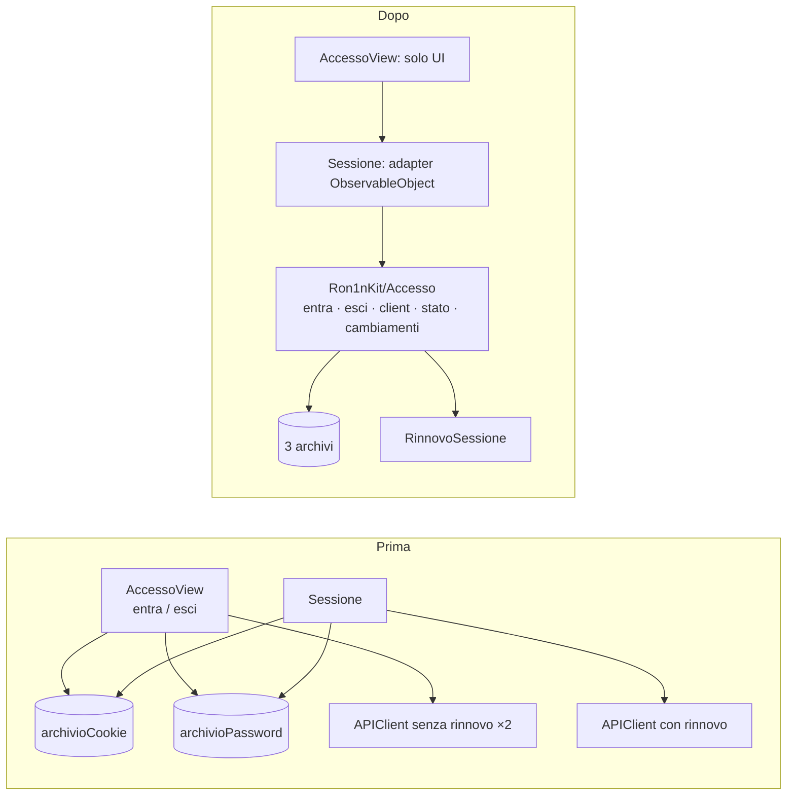
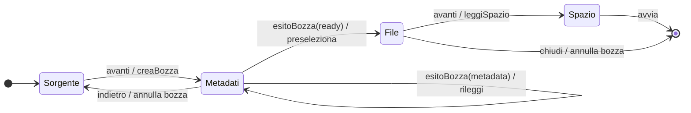

# Revisione dell'architettura: ron1nos-ios

_10 novembre 2026 · skill `improve-codebase-architecture` · ambito: hot spot recenti (`RadiceView.swift`, `Sessione.swift`, `APIClient.swift`, `StatoView.swift`, `HomeView.swift`) e i file più grandi_

Non esistono `GLOSSARY.md` né `docs/adr/`. Il linguaggio di dominio viene da `CLAUDE.md`, dalle spec IOS- e dai commenti nel codice.

**Vocabolario.** _modulo_ (module) · _interfaccia_ (interface) · _implementazione_ · _profondità_ (deep/shallow) · _seam_ · _adapter_ · _leverage_ · _locality_.

## Cosa già funziona

- **Il seam fra Ron1nKit e Ron1nOS regge per la rete.** Nessuna vista usa `URLSession`, `JSONDecoder` o `DateFormatter`.
- **`APIClient` (273 righe) è già un modulo deep.**
  - Ha la porta `HTTPTransport` con l'adapter `URLSessionTransport`.
  - Gestisce dentro di sé la cancellazione (IOS-017) e il nuovo tentativo sul 401.
  - È coperto da `APIClientTests` (175 righe) e `LoginRon1nTests` (209 righe).
  - Non serve uno stub `URLProtocol`.
- **`Carico<Valore>` è un buon modulo di lettura**, usato in 28 viste.

L'attrito sta sopra il client: il ciclo di vita della sessione, l'invalidazione e le macchine a stati dentro le viste. Ron1nOS compila vuoto su Linux, quindi tutto ciò che vive lì non ha test.

## Riepilogo

| # | Candidato | Forza | Dipendenze |
|---|---|---|---|
| 1 | Modulo Accesso: ciclo di vita del login (IOS-019) | **Strong** | local-substitutable |
| 2 | Invalidazione per ambito al posto dei contatori sparsi | **Strong** (bug) | in-process |
| 3 | Wizard dei torrent come macchina a stati in Kit | **Strong** | in-process + local-substitutable |
| 4 | Preferenze ottimistiche e instradamento dei file fuori da `Sessione` | Worth exploring | local-substitutable |
| 5 | `Scrittura`: il gemello di `Carico` per le mutazioni | Worth exploring | in-process |
| 6 | Modelli scritti a mano contro `openapi.yaml` | Speculative | mock (fixture) |

---

## 1. Modulo Accesso: ciclo di vita del login — **Strong**

**Dipendenze:** local-substitutable. `TestoInMemoria` e il transport finto esistono già.

**File**
- `Sources/Ron1nOS/Sessione.swift` (196): gestisce tre archivi (`archivio`, `archivioCookie`, `archivioPassword`), `var client` (un `APIClient` nuovo a ogni accesso), `credenzialiCambiate()`, `versione`.
- `Sources/Ron1nOS/AccessoView.swift` (228):
  - `entra()` (L178-213): costruisce un client senza rinnovo, salva il cookie, salva o cancella la password a seconda di Face ID e traduce `EsitoAccesso`;
  - `esci()` (L216-226).
- `Sources/Ron1nKit/LoginRon1n.swift` (209): `RinnovoSessione`, `StatoLogin`.

**Prima → Dopo**

**Problema.** Le invarianti del login vivono nell'implementazione di una vista che non si può testare:
- dopo il login si salva il cookie, e la password solo se Face ID è attivo;
- il logout non deve innescare il rinnovo;
- un cambio di credenziali deve incrementare `versione`.

La costruzione di un client "base" senza rinnovo è ripetuta in 3 posti: `APIClient` L223 e `AccessoView` L185 e L221.

Deletion test su `entra`/`esci`: se li togli dalla vista, la complessità si sposta altrove. È logica di dominio parcheggiata in una vista.

**Soluzione.** Un modulo `Ron1nKit/Accesso` che possiede gli archivi e `RinnovoSessione`. `Sessione` resta un adapter sottile.

**Benefici**
- Login, logout, "ricorda con Face ID sì/no" e "esci non chiede Face ID" diventano test su Linux. Oggi la copertura è zero.
- Locality: tutto il ciclo di vita del login sta in un modulo.

---

## 2. Invalidazione per ambito — **Strong**

**Dipendenze:** in-process.

**File**
- `Sessione.swift` L36-47: `versione`, `palestraCambiata`, `documentiCambiati`, `layoutCambiato`.
- 14 consumatori via `.task(id:)`, con chiavi costruite a stringa.
- 12 produttori che incrementano a mano: `EserciziView`, `StoricoView`, `ImportCSVView`, `NuovoDocumentoView`, `DettaglioDocumentoView`, `ImpostazioniRon1nView`, `SistemaView`, …

**Prima → Dopo**

| Prima | Dopo |
|---|---|
| ogni vista sceglie i propri contatori | `enum Ambito { login, palestra, documenti, layout, dieta }` |
| il login (`versione`) va ricordato a mano | il login è implicito in ogni chiave |
| ogni mutazione incrementa il contatore giusto, se se lo ricorda | `segna(_:)`, oppure la scrittura dichiara l'ambito che sporca |

**Bug (verificato).** `StoricoView:67` usa solo `palestraCambiata`, e `DocumentiView:90` solo `documentiCambiati`. Dopo un nuovo login, queste viste non ricaricano. Lo stesso vale per `EserciziView`, `VolumeGruppiView` e `ImpostazioniRon1nView:254`.

`DietaView` ha il problema opposto: usa solo `versione` e non segue nessun contatore di modulo.

**Benefici**
- Locality: la regola di ricarica sta in un posto.
- "Il login invalida tutto" e "l'import CSV invalida la palestra" diventano test unitari.

---

## 3. Wizard dei torrent come macchina a stati — **Strong**

**Dipendenze:** in-process (riduttore puro) + local-substitutable (un driver con `HTTPTransport` finto).

**File**
- `Sources/Ron1nOS/AggiungiTorrentView.swift` (572): 14 `@State` e le funzioni `vai(a:)` L460, `leggi()` L253, `aggiorna(_:)` L270, `aspettaMetadati` L281 (polling), `avvia` L385, `puoAvanzare`, `.onDisappear` L96.
- `Sources/Ron1nKit/AggiungiTorrent.swift` (374): contiene solo parti shallow (`Link`, `NodoFile`, `Spazio`).

**Prima → Dopo**

_Dopo:_ `struct WizardTorrent` in Kit prende in ingresso stato ed evento e restituisce un nuovo stato e degli effetti. Un piccolo driver async esegue gli effetti. La vista legge lo stato e invia gli eventi.

**Problema**
- Le regole del wizard (indietro butta la bozza, uscire annulla, preselezione all'arrivo dei metadati, quando si può avanzare) stanno nella vista e non sono testabili.
- `BozzaTorrent.status` è una `String`, mentre `openapi.yaml` lo definisce come `enum [ready, metadata, timeout]`. Il valore `"metadata"` è un letterale scritto nella vista.

**Benefici**
- `AggiungiTorrentTests` passa dal coprire solo albero, link e spazio al coprire transizioni, annullamento e polling.
- `status` diventa un enum.
- Lo stesso schema vale per `NuovoDocumentoView.swift` (405), con forza Worth exploring.

---

## 4. Preferenze ottimistiche e instradamento dei file fuori da `Sessione` — Worth exploring

**Dipendenze:** local-substitutable.

**File:** `Sessione.swift`:
- `salva(_:)` L90: applica subito e fa rollback se il backend rifiuta;
- `caricaSfondo` L119: cache per versione;
- `apri(file:)` L135: instradamento di magnet, csv e torrent;
- `mostra` L168.

**Problema.** `Sessione` è un god-object `@MainActor` che dipende da UIKit. Il rollback e l'instradamento sono regole senza test (`ModificaPreferenze.applicata` è testata, il rollback no).

**Soluzione**
- `Ron1nKit/StatoPreferenze`, che tratta lo sfondo come `Data` e lascia `UIImage` all'adapter.
- `ArrivoFile.instrada(url)` in Kit.

**Benefici**
- Rollback, cache dello sfondo e instradamento diventano testabili su Linux.

---

## 5. `Scrittura`: il gemello di `Carico` per le mutazioni — Worth exploring

**Dipendenze:** in-process.

**File**
- `DietaView` L89 e L102
- `ImpostazioniRon1nView` (535): il testo "non salvato · riprova" compare 4 volte
- `AccountView` L130 e L140
- `@State var errore: String?` in 10 viste

**Problema.** Lo stesso schema di 6-8 righe (`Task { do … catch { mostra(.nonSalvato) { retry } } }`) è ripetuto ovunque, e i testi sono scritti nelle viste.

**Soluzione.** Un tipo `Esito<T>` con l'ambito da invalidare. Si lega al candidato 2.

**Benefici**
- Leverage: un'interfaccia sola per tutte le scritture.
- La mappatura dei testi di errore diventa testabile.

---

## 6. Modelli scritti a mano contro `openapi.yaml` — Speculative

**Dipendenze:** mock (fixture JSON).

**Problema**
- Circa 127 tipi `Codable` in Kit, senza nessun controllo contro `ron1nOS/api/openapi.yaml`.
- La deriva si vede già: enum diventati `String` (`BozzaTorrent.status`, lo stato del piano in `DietaView:89`).
- Un errore di decodifica diventa `.rispostaInattesa(codice: nil)`, senza dire cosa.

**Soluzione.** Fixture JSON prese dagli `example` di openapi e decodificate nei test. Il codegen con swift-openapi-generator è possibile ma costoso.

È lo stesso problema del candidato "una fonte per il contratto" del report di ron1nOS: conviene deciderli insieme.

---

## Termini di dominio da mettere in un GLOSSARY.md

- Sessione, CookieSessione, RinnovoSessione, StatoLogin, EsitoAccesso
- Carico (e il futuro Scrittura)
- Bozza, BozzaTorrent, Passo
- Preferenze, ModificaPreferenze
- Avviso
- Navigazione, Scheda, Pagina (`Pagina` sta ancora in `RadiceView.swift`)
- Modulo spento
- HTTPTransport, ArchivioTesto

## Possibili ADR

- Il seam fra Kit e OS (cosa può stare in una vista).
- Autenticazione con cookie e Face ID al posto del token.

## Raccomandazione principale

**Il #2 e il #1 insieme.**

Il #2 è un bug visibile: le viste non ricaricano dopo un nuovo login. Il punto in cui si risolve è lo stesso ciclo di vita del login che il #1 porta in Kit. Fatti insieme, rendono testabile su Linux la parte dell'app che oggi ha zero copertura.
